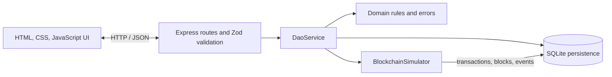

# Ledgerroom Project Documentation

## Current Scope

Ledgerroom is a local full-stack simulation of micro-grant governance and milestone funding. The running application uses a browser UI, Express API, TypeScript service/domain layers, SQLite persistence, and a blockchain-style transaction/event simulator.

It does not operate as a production DAO. No live chain, wallet, cryptocurrency, real funds, or external RPC provider is used. This boundary keeps the workflow reproducible while making the application and audit model inspectable.

## Runtime Architecture



The static browser application is served by Express. Routes validate requests and call `DaoService`; service logic enforces roles and workflow rules; `SqliteStore` persists domain and audit records; `BlockchainSimulator` records local transaction, block, and event lineage for business actions.

## Transaction and Audit Model

Simulated business actions create pending transaction records before the domain callback. Successful actions can emit typed events and create a block linked to its previous block hash; the transaction is then marked confirmed. Failures retain a failed transaction record and return a structured API error. SHA-256 hashes are generated locally.

SQLite stores accounts, proposals, votes, grants, evidence, treasury balance, transactions, blocks, and events. These records provide inspectable history, not consensus, tamper resistance, or immutable-storage guarantees.

## Technology Stack

| Area                | Technology                   | Use                                              |
| ------------------- | ---------------------------- | ------------------------------------------------ |
| Frontend            | HTML, CSS, JavaScript        | Static dashboard, forms, and API requests        |
| Backend             | Node.js, TypeScript, Express | HTTP API and service orchestration               |
| Validation          | Zod                          | Request schemas and validation errors            |
| Persistence         | SQLite with `better-sqlite3` | Domain state and simulated audit records         |
| Hashing             | Node.js `crypto`             | Local SHA-256 hashes                             |
| Testing and quality | Vitest, TypeScript, ESLint   | Behavior tests, type checks, and backend linting |

## Scope and Known Limitations

- No live blockchain, wallet, cryptocurrency, real funds, or external RPC connection.
- Simulation identities are selected local accounts, not authenticated users.
- The service clock is in memory and resets when the backend restarts.
- Milestone evidence, verification, and release are API features without dedicated browser controls.
- Transaction/block/event links are locally persisted audit data, not consensus or immutable-storage guarantees.

Possible future work includes milestone UI controls, durable simulation time, and a separately designed adapter for another execution environment. These are not current capabilities and would require additional implementation and security review.

## Repository Map

```text
backend/src/
  blockchain/      transaction, block, event, and hash simulation
  domain/          types, rules, and domain errors
  persistence/     SQLite store
  services/        DAO workflow service
  http.ts          Express API
  server.ts        startup
backend/test/      domain, integration, and security tests
frontend/          static application
docs/images/       application screenshots
docs/demo/         browser walkthrough video
DEMO.md            setup and verified workflow
```

`contracts/GrantDAO.sol`, `scripts/deploy.js`, `frontend/demo-data.js`, `server.js`, and `docker-compose.yml` are legacy/unconnected to this runtime. See [`DEMO.md`](DEMO.md) for the supported startup process.
