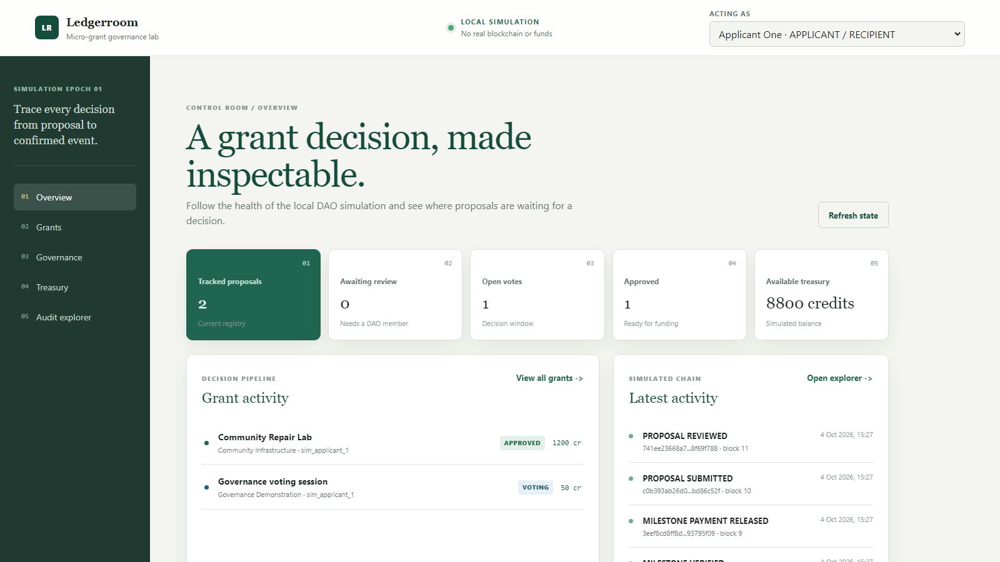
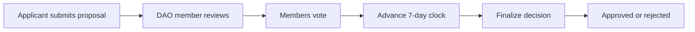
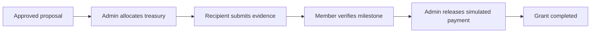
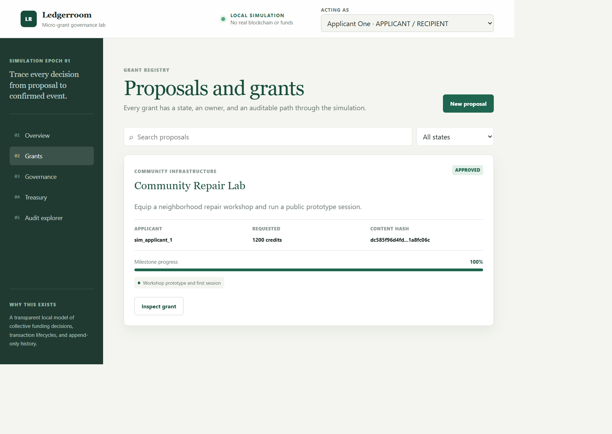
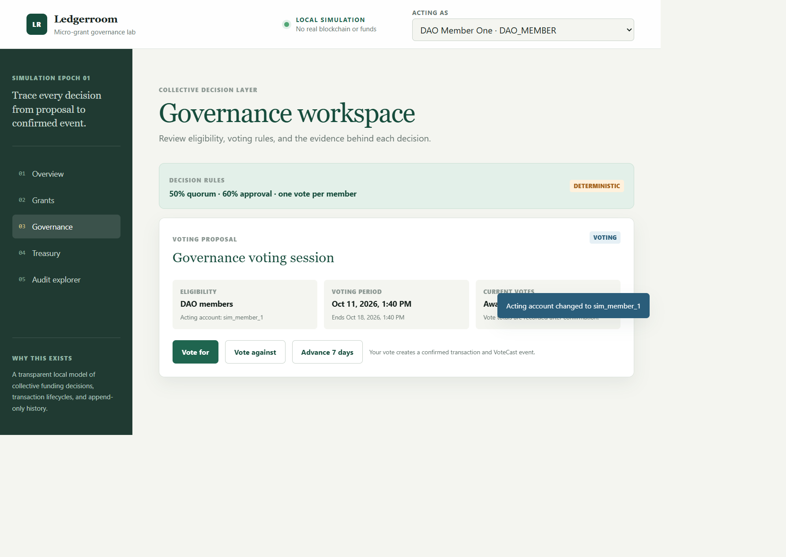
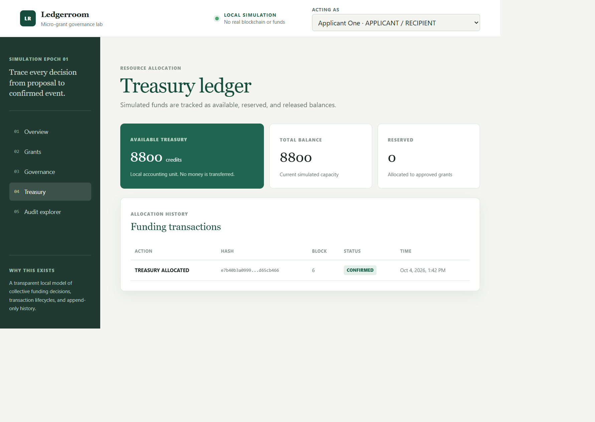
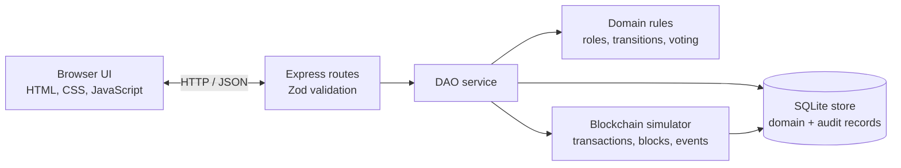
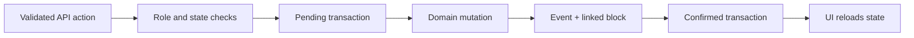
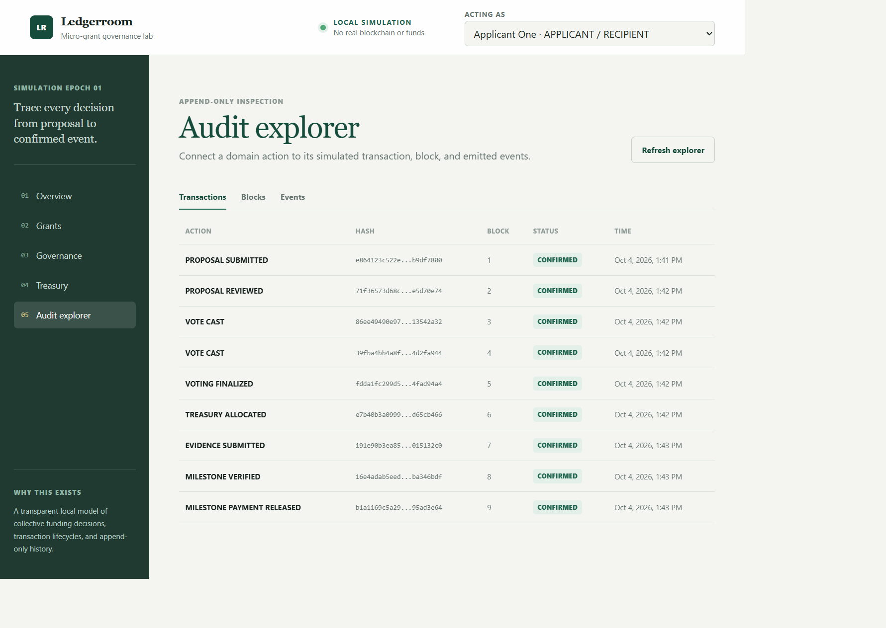

# Ledgerroom: Micro-Grant DAO Simulation

**A full-stack local simulation of grant governance, milestone funding, and blockchain-style audit records.**

Ledgerroom connects a browser UI, API, domain rules, SQLite persistence, and a transaction/event simulator into a complete grant workflow.

> **Simulation only:** no live blockchain, wallet connection, cryptocurrency, or real funds are used. Accounts, transactions, blocks, governance, and funding are simulated locally.

## Purpose

Grant programs need a clear path from application to decision, funding, milestone evidence, and completion. Ledgerroom models that system locally so its governance rules and audit records are inspectable without operating a live chain or handling real assets.

## Core Functionality

- Submit proposals with milestone budgets and validate that the amounts balance.
- Review proposals, cast one vote per simulated DAO member, advance the seven-day clock, and finalize using quorum and approval rules.
- Allocate simulated treasury only to approved proposals.
- Submit, verify, and release milestone work through the API.
- Inspect persisted transactions, blocks, events, treasury records, and grant state in the browser.

## See It Run

<p align="center">
  
</p>

[Watch the 16:9 application tour and workflow (WebM)](docs/demo/demo-workflow.webm) | [Verified setup and walkthrough](DEMO.md)

## What This Project Demonstrates

- **Full-stack engineering:** the static browser UI submits real JSON requests to Express and refreshes its views from API-confirmed state.
- **System design:** route validation, `DaoService`, domain rules, SQLite persistence, and the blockchain simulator have distinct responsibilities.
- **Backend and data engineering:** role checks, state transitions, quorum/approval rules, treasury limits, and unique proposal/voter constraints are enforced outside the browser.
- **Persistence and data modeling:** SQLite stores proposals, votes, grants, evidence, treasury, and audit records; the vote key prevents a member from voting twice on one proposal.
- **Blockchain concepts:** simulated business actions receive hashes and link transactions, blocks, previous-block hashes, and typed events in a queryable audit trail.
- **Reliability and debugging:** Vitest covers domain rules, API workflows, invalid actions, and the local-only RPC guard; the proposal form's async submit path is also regression-checked through the real browser.
- **Engineering judgment:** local accounts, SQLite, and a simulated clock keep the workflow reproducible while avoiding real wallets, external RPC, and financial claims.

## Complete Workflow

### Proposal to Decision



### Funding to Completion



The browser supports proposal submission, review, voting, time advancement, finalization, treasury allocation, and audit inspection. Evidence, verification, and release are API capabilities without dedicated UI controls; the [verified demo guide](DEMO.md) includes those requests.

<p align="center">
  
</p>

### Governance

The backend allows one vote per simulated DAO member, requires quorum equal to at least 50% of eligible members, and requires at least 60% support with more FOR than AGAINST votes to approve. These rules are checked during finalization rather than trusted to the browser.

<p align="center">
  
</p>

### Treasury and milestones

Only approved proposals can receive a treasury allocation, subject to available simulated balance. Evidence submission, milestone verification, and payment release are API capabilities without dedicated browser controls.

<p align="center">
  
</p>

## Architecture



The backend is the source of truth. Express serves the static frontend and validates API requests; `DaoService` coordinates actions; domain rules control transitions; SQLite stores domain and audit records; and the simulator records local transaction/event lineage.

## Blockchain Simulation

This is an application-level model, not a blockchain node or consensus implementation. For simulated business actions, the service checks actor and domain state; the simulator saves a pending transaction, executes the domain mutation, creates related events and a block linked to its predecessor, and saves the transaction as confirmed. Failed actions retain a failed transaction and return an API error.

### Simulated Transaction Lifecycle



SQLite stores accounts, proposals, votes, grants, evidence, transactions, blocks, and events. SHA-256 hashes are computed locally. Events link aggregates to transactions and blocks, and the explorer makes that lineage inspectable. The records do not provide consensus, tamper resistance, or immutable storage guarantees.

<p align="center">
  
</p>

Additional audit explorer views are available as supporting screenshots: [linked blocks](docs/images/audit-blocks.png) and [typed events](docs/images/audit-events.png).

The time-advance endpoint only changes the service's in-memory clock; it creates no transaction or event and resets when the backend restarts.

## Engineering Details

### Frontend and API boundary

The UI is plain HTML, CSS, and JavaScript. It loads accounts, proposals, transactions, blocks, events, and treasury through API requests, then rerenders from returned backend state. Mutations pass a selected simulated account in a request header; the browser does not decide governance outcomes.

### Domain and persistence

`DaoService` coordinates workflow actions. Domain rules validate proposal data and transitions, require roles, prevent duplicate votes, check deadlines, calculate voting results, and constrain funding and milestone releases. `SqliteStore` persists JSON domain records in SQLite alongside relational keys and a unique proposal/voter constraint.

## Technology Stack

| Area        | Technology                       | Role in this project                                               |
| ----------- | -------------------------------- | ------------------------------------------------------------------ |
| Frontend    | HTML, CSS, JavaScript            | Static dashboard, forms, browser state rendering, and API requests |
| Backend     | Node.js 20+, TypeScript, Express | HTTP API and application/service orchestration                     |
| Validation  | Zod                              | Request body schemas and structured validation errors              |
| Persistence | SQLite with `better-sqlite3`     | Domain state and simulated ledger records                          |
| Hashing     | Node.js `crypto`                 | Local SHA-256 hashes for content, transactions, and blocks         |
| Testing     | Vitest                           | Domain, integration, and security-boundary behavior                |
| Quality     | TypeScript, ESLint               | Static type checking and backend linting                           |

## Testing

Three Vitest files contain 9 tests covering governance rules, transaction/block/event linkage, role and duplicate-vote rejection, the complete API grant lifecycle including simulated time advancement, validation errors, and the local-only RPC guard. No coverage percentage is claimed.

```bash
npm test
npm run typecheck
npm run lint
```

## Getting Started

Requirements: Node.js 20 or later and npm.

```bash
npm install
npm run dev
```

Open [http://localhost:3004](http://localhost:3004). The full verified walkthrough is in [`DEMO.md`](./DEMO.md).

The server reads `PORT` (default `3004`) and `SIMULATION_DB` (default `simulation.db`) from its process environment. `.env.example` is a reference; `npm run dev` does not automatically load a `.env` file.

## Security and Trust Boundaries

The backend validates request bodies, checks simulated roles and lifecycle transitions, prevents duplicate votes, and maps expected failures to structured API errors. The local-only RPC URL guard rejects non-local values; the current application does not call an RPC provider.

The account selector and `x-simulation-account` header are demonstration identities, not authentication. There are no real wallets, private keys, tokens, or funds. This is not a production security or financial system.

## Scope and Limitations

- No live blockchain, wallet connection, cryptocurrency, or real funds.
- The simulation clock is in memory and resets when the backend restarts.
- Evidence submission, milestone verification, and release are API capabilities without dedicated browser controls.
- Transaction, block, and event records provide local audit lineage, not consensus or tamper resistance.
- The root Compose file refers to absent historical `labs/...` paths and is not a supported way to run this application.
- The Solidity contract, deploy script, `frontend/demo-data.js`, and root `server.js` are legacy/unconnected artifacts, not part of the current runtime.

Future work could add browser controls for milestone actions, persist the simulation clock, or replace the simulator with a separately designed blockchain adapter. Each would require additional implementation, tests, and security review; none is represented as a current feature.

## Repository Map

```text
backend/src/
    blockchain/      transaction, block, event, and hashing simulation
    domain/          types, state rules, and domain errors
    persistence/     SQLite storage
    services/        DAO workflow orchestration
    http.ts          Express API and request validation
    server.ts        local application startup
backend/test/      domain, integration, and security-boundary tests
frontend/          static UI and browser-side API integration
docs/images/       screenshots captured from the running application
docs/demo/         recorded browser walkthrough
DEMO.md            verified local setup and user/API workflow
PROJECT_DOCUMENTATION.md
SEQUENCE_DIAGRAMS.md
```

For the verified setup and complete workflow, continue with [`DEMO.md`](./DEMO.md).
