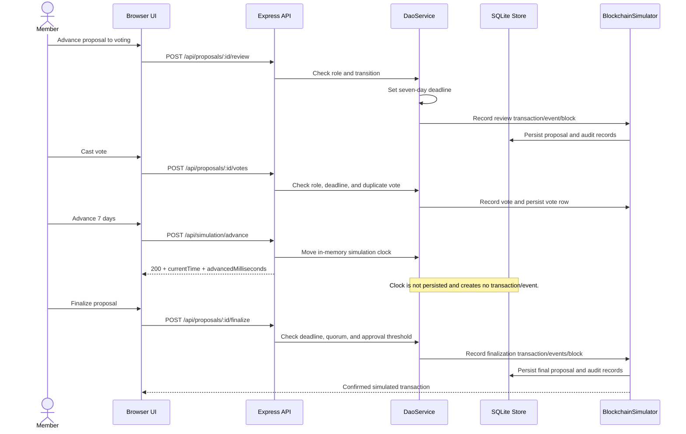
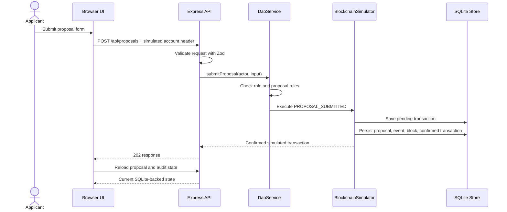
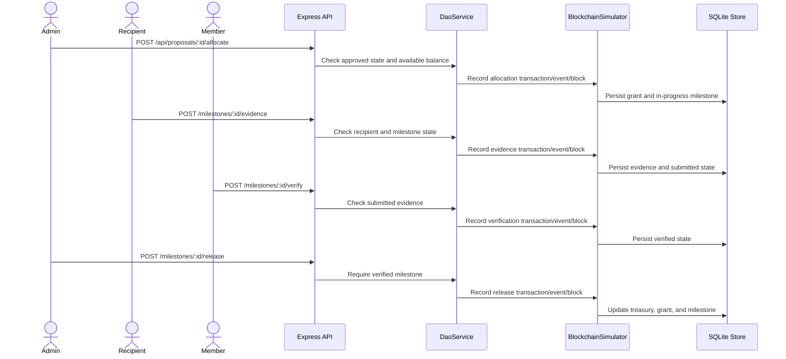

# Current Application Flows

These diagrams describe the TypeScript/Express/SQLite simulation in this repository. None of the flows calls a wallet, deployed contract, blockchain node, or external RPC provider.

---

## Governance and Time Advancement

---

## Proposal Submission

## Treasury and Milestone API Actions

Milestone actions exist as API routes; the browser currently has no dedicated controls for them.

---
